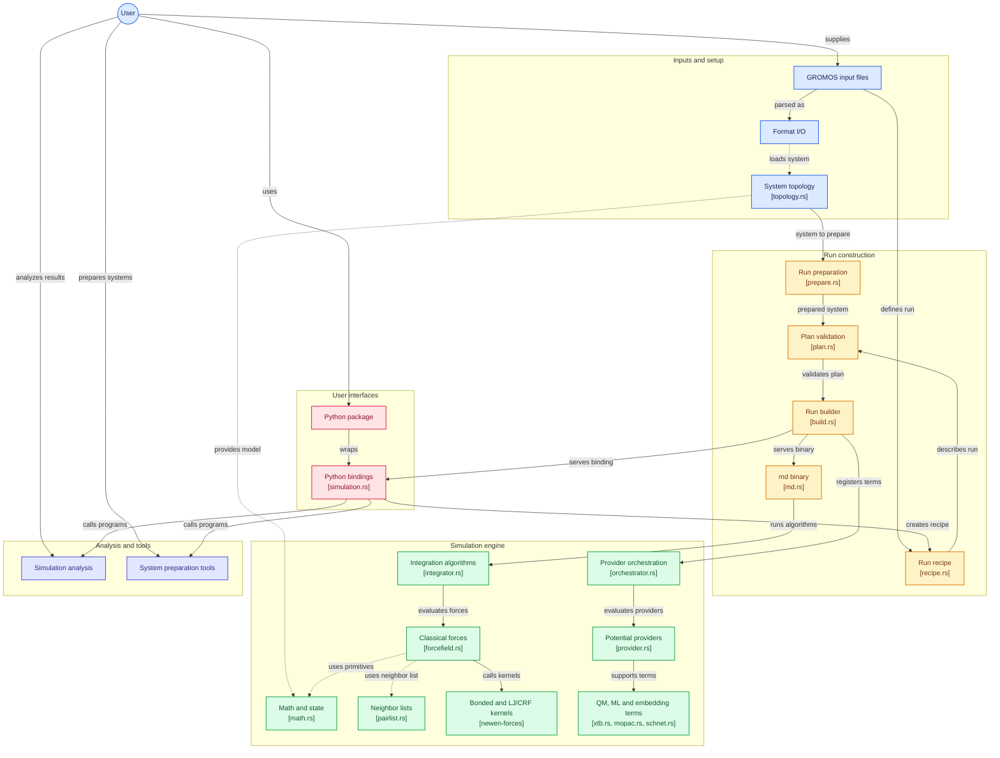

# newen

*Newen* is Mapudungun for force. newen is a Rust and Python reimplementation of the GROMOS
molecular dynamics engine and its analysis tools; it was called gromos-rs until version 0.0.66.

## License

**newen** is licensed under the GNU General Public License v2.0 or later (GPL-2.0-or-later), matching the original gromosXX license.

- Copyright (C) 2025 Yerko Escalona
- Based on GROMOS software (Copyright by Biomos b.v. and GROMOS development team)
- See [LICENSE](LICENSE) file for full license text

This ensures that newen remains free and open-source software, consistent with the GROMOS project's values.

## newen: Modern Rust and Python Implementation

This repository contains **newen**, a modern reimplementation of GROMOS features in Rust with Python bindings, designed for high performance and ease of use.

### Quick Start

```bash
# Rust: build the md binary and run the workspace tests (incl. the gromosXX reference suite)
cargo build --release --bin md
make test                      # cargo test --workspace

# Python: build the extension into py-newen/.venv and run the Python suite
make test-python               # uv sync --all-groups (builds the extension) + pytest
make build-release             # optimised extension build when timing matters

# Format, lint, and the full local CI pass (fmt-check + lint + test)
make fmt lint-rust
make ci
```

`just ref` / `just lint` (see `Justfile`) run the reference suite and clippy plus the G6 drift
gates; `INSTALL.md` lists the toolchain and the optional QM/ML layers.

### Components

- **newen** (`crates/`): the Rust workspace — `newen-core` (topology, configuration, math,
  the `Algorithm` trait), `newen-forces` (bonded/nonbonded kernels, restraints, the QM/ML
  provider orchestrator), `newen-integrators` (leap-frog, thermostats, barostats, SHAKE/SETTLE/
  LINCS), `newen-io` (GROMOS file formats, the lossless `.imd` reader/writer), `newen-run` (the
  one run builder: recipe → plan → algorithms), `newen-md` (the `md` binary and the gromosXX
  reference suite), `newen-analysis` / `newen-tools` (ports of gromos++ programs)
- **py-newen** (`py-newen/`, `crates/pyo3-newen`): Python bindings — `System`, `Recipe`, `Plan`,
  `Term`, `Simulation`
- **Free-energy driver** (`newen.free_energy`): perturbations from a `.ptp` or made in Python
  (`Perturbation.from_ptp` / `.mutate`), λ windows (`LambdaSchedule`, `run_windows` in worker
  processes) and TI, BAR and MBAR on them ([user guide](py-newen/docs/user-guide/free-energy.md))
- **gromos++ analysis ports** (`crates/newen-analysis`, `newen.analysis`): the gromos++ analysis
  programs as binaries and library calls (`ene_ana`, `rdf`, `ext_ti_ana`, `bar`, `dfmult`,
  `dGslv_pbsolv`, …), with reference tests against gromos++ output in `crates/newen-analysis/tests/`

### How a run is described

One data structure — the **recipe** — describes a run for both entry points. A GROMOS `.imd`
file *is* a recipe (read losslessly, written back in a form gromosXX runs identically), and so is
a Python `Recipe`; both go through the same builder in `newen-run` (`prepare_system → build_plan
→ validate_plan → instantiate → start`), so the gromosXX reference suite (driving the `md`
binary) and the Python suite (driving the binding) test one code path from two sides.

```python
from newen import System, Recipe, Term, Simulation

system = System.from_files("system.topo", "start.cnf")
recipe = Recipe.from_imd("run.imd")          # or Recipe.nvt(dt=0.002, steps=5000, temperature=300.0)
recipe = recipe.with_term(Term("xtb", region="1:a", elements=[8, 1, 1]))   # a QM term, additive
sim = Simulation(system, recipe)
energies = sim.run(5000, ene_freq=100)       # (n_frames, 12) numpy array
print(sim.total_energy, sim.term_energies)
```

The plan — the ordered algorithms of one MD step — is data too: `recipe.plan(system)` returns it,
editable and re-validated. Design and drift guards: item 3.9 in [CHANGELOG.md](CHANGELOG.md); user guide:
[py-newen/docs/user-guide/recipe.md](py-newen/docs/user-guide/recipe.md).

### Architecture



### CI/CD and Testing

This project uses comprehensive CI/CD inspired by [Polars](https://github.com/pola-rs/polars):

- **Automated Testing**: GitHub Actions workflows for Rust and Python across multiple platforms
- **Code Quality**: Automatic formatting (rustfmt, black) and linting (clippy, ruff)
- **Integration Tests**: Complete test suite ensuring Rust and Python work together
- **Continuous Benchmarking**: Performance tracking across releases
- **Automated Releases**: Build wheels and publish to PyPI/crates.io

**Available Commands:**

| Command | Description |
|---------|-------------|
| `make check` | `cargo fmt` + `cargo check --tests` — run before every commit |
| `make test` | `cargo test --workspace` (incl. the gromosXX reference suite) |
| `make test-python` | `uv sync --all-groups` (builds the extension) + `pytest` |
| `make build-release` | Optimised build of the Python extension (`maturin develop --release`) |
| `make fmt` / `make fmt-check` | Format code / verify formatting |
| `make lint-rust` | Clippy across the workspace |
| `make ci` | fmt-check + lint-rust + test, as CI runs them |
| `make docs` / `make docs-serve` | Build (`--strict`) / serve the py-newen mkdocs site |

**Developer Tools:**

We use comprehensive developer tooling inspired by Polars:
- **Pre-commit hooks**: Automatic code quality checks (`.pre-commit-config.yaml`)
- **rustfmt & clippy**: Rust formatting and linting (allows scientific notation like `kT`)
- **black & ruff**: Python formatting and linting (naming flexibility for science)
- **typos**: Spell checking across the codebase
- **EditorConfig**: Consistent editor settings
- **Scientific naming**: Respects domain conventions (`.typos.toml`, the clippy/ruff settings)

See our documentation:
- [INSTALL.md](INSTALL.md) - **Full dependency list** (Rust/Python, C++ reference sources, QM engines, ML stack)
- [CHANGELOG.md](CHANGELOG.md) - Release history and the item index that resolves the ids code comments cite
- Work queue: a private project board (`Icebox` → `Ready` → `Doing` → `Done`)
- Reference-test status: `crates/newen-md/.claude/CONTEXT.md`
- [py-newen/docs/](py-newen/docs/) - Python user guide (quick start, the recipe model, API reference); `mkdocs serve` in `py-newen/`
- [BENCHMARKING.md](BENCHMARKING.md) - Engine-vs-gromosXX benchmarks, kernel determinism
- [CONTRIBUTING.md](CONTRIBUTING.md) - How to build, test and contribute; [CHANGELOG.md](CHANGELOG.md) - What changed, per version
- [CONTRIBUTING.md](CONTRIBUTING.md) - Contribution guidelines

---

## ⚠️ IMPORTANT DISCLAIMER

**THIS IS NOT AN OFFICIAL BIOMOS REPOSITORY**

This repository is an **independent, educational reimplementation** of GROMOS functionality in Rust and Python. It is **fully based on gromosXX (md++) and gromosPlusPlus**, which are the official C++ implementations maintained by [Biomos b.v.](https://www.gromos.net).

### Purpose and Scope

This project aims to:
- **Unify** the approaches from both gromosXX and gromosPlusPlus codebases
- **Leverage** Rust's efficient compiler for high-performance molecular dynamics
- **Provide** modern Python bindings for ease of use
- **Serve** as an **educational resource** for learning MD algorithms and Rust/Python interoperability

### ⚠️ NOT FOR PRODUCTION USE

**This software is for educational purposes only.** It is **NOT intended for actual research or scientific work** at this stage. The codebase requires **several iterations of development, validation, and testing** before it could be considered for production use.

**For official GROMOS software**, please visit:
- Official website: [www.gromos.net](https://www.gromos.net)
- Official repositories maintained by Biomos b.v.

### Acknowledgments

This educational project is built upon the foundational work of the GROMOS developers. All scientific credit belongs to the original GROMOS team. See the references section below for proper citations.

## About the GROMOS software for biomolecular simulation

### What is GROMOS

GROMOS is an acronym of the GROningen MOlecular Simulation computer program package, which has been developed since 1978 for the dynamic modelling of (bio)molecules, until 1990 at the University of Groningen, The Netherlands, and since then at the ETH, the Swiss Federal Institute of Technology, in Zürich, Switzerland. Its development was driven by the [research group of Wilfred van Gunsteren.](http://www.igc.ethz.ch) Currently, the development is shared between him and the research groups of [Philippe Hünenberger](http://www.csms.ethz.ch) and [Sereina Riniker](http://www.riniker.ethz.ch) at the ETH, of [Chris Oostenbrink](http://www.map.boku.ac.at/mms/) at the University of Natural Resources and Life Sciences in Vienna, Austria, and of [Niels Hansen](http://www.itt.uni-stuttgart.de/en/institute/team/staff/Hansen/) at the University of Stuttgart, Stuttgart, Germany.

Since the official releases of the GROMOS software and manual in 1987 and 1996, a major comprehensive release occurred in 2011\. The GROMOS software has seen a steady development since 1987, see e.g. [1]. The programming language has been changed from FORTRAN to C++, the documentation has been put into electronic form, and many new features have been included in the software. Since 2011, regular releases of GROMOS took place in 2012, 2016, 2018, 2021 and 2023.

The GROMOS _software_ is to be distinguished from the GROMOS _force fields_ for biomolecular systems, of which the latest versions are coded as:

<table border="0">

<tbody>

<tr>

<td>45A3/4</td>

<td>Comprehensive GROMOS96 parameter set [2-5]</td>

</tr>

<tr>

<td>53A5/6</td>

<td>Reparameterization of polar groups [6]</td>

</tr>

<tr>

<td>54A7</td>

<td>Optimization of lipids [7] and protein backbone [8]</td>

</tr>

<tr>

<td>54A8</td>

<td>Reparameterization of charged groups [9]</td>

</tr>

</tbody>

</table>

### GROMOS documentation

Extensive GROMOS software manuals accompanied the major releases of 1987 [10] and 1996 [11]. The functionalities of GROMOS87, GROMOS96 and GROMOS05 are summarized in the scientific literature [1, 12, 13].

The current GROMOS manual and user guide consists of nine volumes, which are available at the [GROMOS website](https://www.gromos.net):

The GROMOS Software for (Bio)Molecular Simulation

Volume 1: About the GROMOS Package: Overview<br>
Volume 2: Algorithms and Formulae for Modelling of Molecular Systems<br>
Volume 3: Force Fields and Topology Data Set<br>
Volume 4: Data Structures and Formats<br>
Volume 5: Program Library Manual<br>
Volume 6: Technical Details<br>
Volume 7: Tutorial with Examples<br>
Volume 8: Installation Guide<br>
Volume 9: Index

The architecture and different functionalities of the current version of GROMOS are described in the a number of papers [14]-[20].

The GROMOS C++ code is documented in the code in the form of a _doxygen_ documentation. It is accompanied by make files, etc. and by example files. A basic tutorial is available in volume 7 of the GROMOS manual (see above). The files required for this tutorial, are available from the downloads page on this website. A more advanced set of tutorials can be found in [21]

### Distribution of GROMOS software and manuals

Information on GROMOS is available at [www.gromos.net](https://www.gromos.net) which is owned and maintained by Biomos b.v., Laboratory of Physical Chemistry, HCI, ETH Hönggerberg, 8093 Zürich, Switzerland.

GROMOS users are obliged to properly acknowledge the use of the software, e.g. by referencing one or more of the mentioned scientific papers.

Although we are continuously testing the GROMOS software, it goes without saying that we cannot be held responsible for any damage caused by errors in the software or data files.

GROMOS is published under the GNU General Public License [(GPLv2)](https://www.gnu.org/licenses/gpl-2.0.html)

### References

1.  M. Christen, P. H. Hünenberger, D. Bakowies, R. Baron, R. Bürgi, D. P. Geerke, T. N. Heinz, M. A. Kastenholz, V. Kräutler, C. Oostenbrink, C. Peter, D. Trzesniak, and W. F. van Gunsteren, _The GROMOS software for biomolecular simulation: GROMOS05_, J. Comput. Chem. **26** (2005) 1719-1751, doi: [10.1002/jcc.20303](https://doi.org/10.1002/jcc.20303)
2.  L.D. Schuler, X. Daura, W.F. van Gunsteren, _An improved GROMOS96 force field for aliphatic hydrocarbons in the condensed phase._, J. Comput. Chem. **22** (2001) 1205-1218, doi: [10.1002/jcc.1078](https://doi.org/10.1002/jcc.1078)
3.  I. Chandrasekhar, M. Kastenholz, R.D. Lins, C. Oostenbrink, L.D. Schuler, D.P. Tieleman, W.F. van Gunsteren, _A consistent potential energy parameter set for lipids: Dipalmitoylphosphatidylcholine as a benchmark of the GROMOS96 45A3 force field_, Eur. Biophys. J. **32** (2003) 67-77, doi: [10.1007/S00249-002-0269-4](https://doi.org/10.1007/S00249-002-0269-4)
4.  T.A. Soares, P.H. H<c3><bc>nenberger, M.A. Kastenholz, V. Kr<c3><a4>utler, T. Lenz, R.D. Lins, C. Oostenbrink, W.F. van Gunsteren, _An improved nucleic-acid parameter set for the GROMOS force field_, J. Comput. Chem. **26** (2005) 725-737, doi: [10.1002/Jcc.20193](https://doi.org/10.1002/Jcc.20193)</a4></c3></bc></c3>
5.  R.D. Lins, P.H. Hünenberger, _A new GROMOS parameter set for hexopyranose-based cardohydrates_, J. Comput. Chem. **26** (2005) 1400 - 1412, doi: [10.1002/jcc.20275](https://doi.org/10.1002/jcc.20275)
6.  C. Oostenbrink, A. Villa, A.E. Mark, W.F. van Gunsteren, _A biomolecular force field based on the free enthalpy of hydration and solvation: the GROMOS force-field parameter sets 53A5 and 53A6_, J. Comp. Chem. **25** (2004) 1656-1676, doi: [10.1002/jcc.20090](https://doi.org/10.1002/Jcc.20090)
7.  D. Poger, W.F. van Gunsteren, A.E. Mark, _A new force field for simulating phosphatidylcholine bilayers_, J. Comput. Chem. **31** (2010) 1117-1125, doi: [10.1002/jcc.21396](https://doi.org/10.1002/jcc.21396)
8.  N. Schmid, A.P. Eichenberger, A. Choutko, S. Riniker, M. Winger, A.E. Mark, W.F. van Gunsteren, _Definition and testing of the GROMOS force-field versions: 54A7 and 54B7_, Eur. Biophys. J. **40** (2011) 843-856, doi: [10.1007/s00249-011-0700-9](https://doi.org/10.1007/s00249-011-0700-9)
9.  M. M. Reif, P. H. Hünenberger, and C. Oostenbrink, _New interaction parameters for charged amino acid side chains in the GROMOS force field_, J. Chem. Theory Comput. **8** (2012) 3705-3723, doi: [10.1021/ct300156h](https://doi.org/10.1021/ct300156h)
10.  W. F. van Gunsteren and H. J. C. Berendsen, _Groningen Molecular Simulation (GROMOS) Library Manual_, Biomos, Groningen, The Netherlands, 1987, pp. 1-221.
11.  W. F. van Gunsteren, S. R. Billeter, A. A. Eising, P. H. Hünenberger, P. Krüger, A. E. Mark, W. R. P. Scott, and I. Tironi, _Biomolecular Simulation: The GROMOS96 Manual and User Guide_, Vdf Hochschulverlag an der ETH Zürich, Zürich, Switzerland, 1996, p. II-30.
12.  W. R. P. Scott and W. F. van Gunsteren, _The GROMOS Software Package for Biomolecular Simulations_, In: _Methods and Techniques in Computational Chemistry: METECC-95,_ E. Clementi and G. Corongiu editors, STEF, Cagliari, Italy, 1995, pp. 397-434.
13.  W. R. P. Scott, P. H. Hünenberger, I. G. Tironi, A. E. Mark, S. R. Billeter, J. Fennen, A. E. Torda, T. Huber, P. Krüger, and W. F. van Gunsteren, _The GROMOS Biomolecular Simulation Package,_ J. Phys. Chem. A **103** (1999) 3596-3607, doi: [10.1021/jp984217f](https://doi.org/10.1021/jp984217f)
14.  N. Schmid, C. D. Christ, M. Christen, A. P. Eichenberger, and W. F. van Gunsteren, _Architecture, Implementation and Parallelisation of the GROMOS Software for Biomolecular Simulation_, Comp. Phys. Commun. **183** (2012) 890-903, doi: [10.1016/j.cpc.2011.12.014](https://doi.org/10.1016/j.cpc.2011.12.014)
15.  A. P. E. Kunz, J. R. Allison, D. P. Geerke, B. A. C. Horta, P. H. Hünenberger, S. Riniker, N. Schmid, and W. F. van Gunsteren, _New Functionalities in the GROMOS Biomolecular Simulation Software,_ J. Comput. Chem. **33** (2012) 340-353, doi: [10.1002/jcc.21954](https://doi.org/10.1002/jcc.21954)
16.  S. Riniker, C. D. Christ, H. S. Hansen, P. H. Hünenberger, C. Oostenbrink, D. Steiner, and W. F. van Gunsteren, _Calculation of Relative Free Energies for Ligand-Protein Binding, Solvation and Conformational Transitions using the GROMOS Software,_ J. Phys. Chem. B **115** (2011) 13570-13577, doi: [10.1021/jp204303a](https://doi.org/10.1021/jp204303a)
17.  N. Schmid, J. R. Allison, J. Dolenc, A. P. Eichenberger, A. P. E. Kunz, and W. F. van Gunsteren, _Biomolecular Structure Refinement using the GROMOS Simulation Software,_ J. Biomol. NMR **51** (2011) 265-281, doi: [10.1007/s10858-011-9534-0](https://doi.org/10.1007/s10858-011-9534-0)
18.  A. P. Eichenberger, J. R. Allison, J. Dolenc, D. P. Geerke, B. A. C. Horta, K. Meier, C. Oostenbrink, N. Schmid, D. Steiner, D. Wang, and W. F. van Gunsteren, _The GROMOS++ Software for the Analysis of Biomolecular Simulation Trajectories,_ J. Chem. Theory Comput. **7** (2011) 3379-3390i, doi: [10.1021/ct2003622](https://doi.org/10.1021/ct2003622)
19.  S.J. Bachmann, W.F. van Gunsteren, _On the compatibility of polarisable and non-polarisable models for liquid water_, Mol. Phys. **112** (2014) 2761-2780, doi: [10.1080/00268976.2014.910317](https://doi.org/10.1080/00268976.2014.910317)
20.  N. Hansen, F. Heller, N Schmid, W.F. van Gunsteren, _Time-averaged order parameter restraints in molecular dynamics simulations_, J. Biomol. NMR **60** (2014) 169-187, doi: [10.1007/s10858-014-9866-7](https://doi.org/10.1007/s10858-014-9866-7)
21.  B. Lier, C. Öhlknecht, A. de Ruiter, J. Gebhardt, W. F. van Gunsteren, C. Oostenbrink, N. Hansen, _A suite of advanced tutorials for the GROMOS biomolecular simulation software [article v1.0]_, Living J. Comp. Mol. Sci. **2** (2020) 18552, doi: [10.33011/livecoms.2.1.18552](https://doi.org/10.33011/livecoms.2.1.18552)
